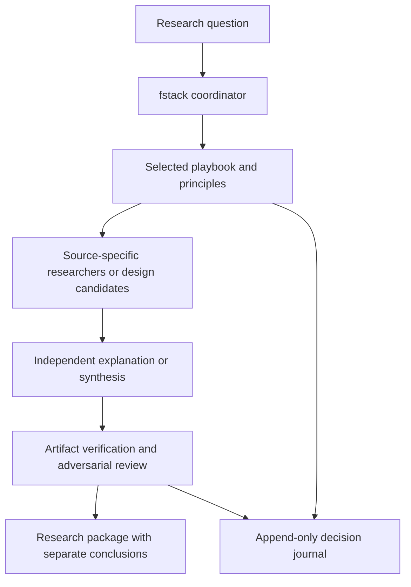

# Architecture

Fstack is a composed skill package with local executable checks. The coordinator reads the task, selects a playbook, loads applicable principles, delegates bounded work and owns the final synthesis. It does not run a separate orchestration service.

## Original mechanisms

`how` distinguishes a simple explanation from complex exploration followed by a separate explainer. `why` investigates source categories and preserves confidence tiers, contradictions and empty searches. `architect` and `arena` compare designs, select a base against a task-specific rubric, graft useful parts and verify the combined artifact. `swarm` tracks coverage or a declared race. `interrogate` retains all reproduced defects rather than selecting a winning reviewer. `reflect` improves the process through separate review lenses and synthesis.

Ordinary worker roles read the coordinator's instructions and relevant principle leaves. Workflow-specific investigators and reviewers retain their narrower contracts. The coordinator reviews actual evidence; a worker's completion statement does not establish success. Worker-owned artifacts avoid competing writes to the same record.

The [adaptation registry](upstream-map.json) records the pinned source, disposition, target and reason for every top-level skill, principle and playbook. The [human-readable map](upstream-map.md) explains domain changes. Development-only resources are outside active financial skill discovery.

## Finance-specific truth boundaries

The source/observation reader, policy checks, verdict and rendered report remain distinct. Factual consistency can be checked; an economic explanation may remain uncertain. Reports therefore separate integrity, thesis support and performance evidence.

The core runtime validates declared sessions, timestamps, identity, units, price conventions and costs. User declarations are not authenticated by a schema. A valid record can still contain a false source assertion. Verification fingerprints exact artifacts and records commands actually run. It cannot prove a claim that its checks do not cover.

Research and experiment manifests define the information cutoff and evaluation protocol. Candidate generation uses development inputs; evaluating, selecting or grafting strategies after observing an evaluation set changes that set's status. No completion condition requires profitable returns.

## Runtime and installation

The Python module `fstack_tools` exposes data checking, run verification, receipt checking, journal append and checkpoint operations. Each strategy case supplies its own executable script rather than depending on a permanent shared backtest engine. Dependencies and reproduction commands travel with the case.

The [project installer](../scripts/install.py) copies a canonical payload under `.agents/fstack/` and creates thin `.agents/skills/` discovery entries. Canonical skill references stay relative to the payload. The installer defaults to a dry run, preflights collisions and never overwrites an edited installation.

The [package checker](../scripts/check_package.py) checks actual file references and source-map coverage. It does not establish market-data authenticity, runtime model diversity, or future investment performance. Codex tool and model adaptation is explicit; unavailable capabilities remain visible gaps.
